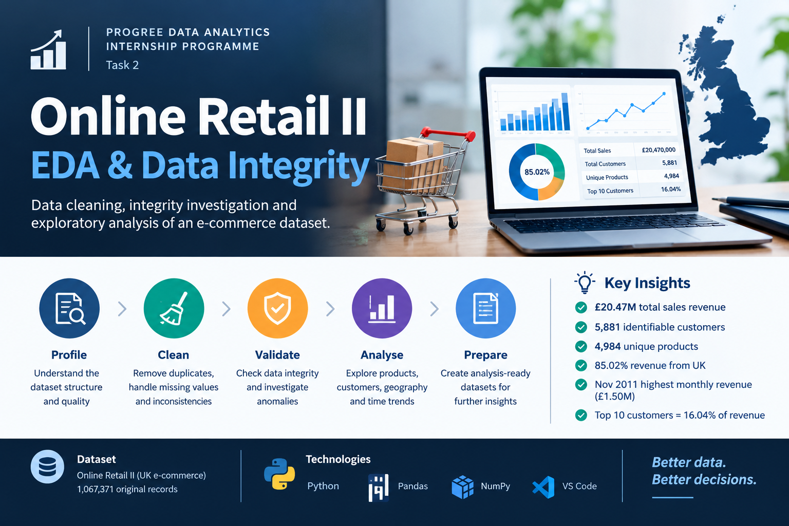

<p align="center">
  
</p>
# Online Retail II – Exploratory Data Analysis & Data Integrity

**A Python-based data cleaning, integrity investigation, and exploratory analysis project.**

Part of the **Progree Data Analytics Internship Programme – Task 2**.

---

## Project Overview

This project investigates the quality, consistency, and business value of the Online Retail II dataset.

The work covers the complete analytical process, from initial dataset profiling and data cleaning to anomaly investigation, exploratory analysis, and final data validation.

Rather than automatically removing unusual records, the project focuses on investigating their context and understanding their potential business meaning.

## Project Objectives

- Profile and understand the original dataset.
- Identify and remove duplicate records.
- Investigate missing values and inconsistencies.
- Examine cancellations, returns, and adjustment transactions.
- Validate transaction dates and numerical fields.
- Investigate unusual quantities, prices, and transaction values.
- Analyse product, customer, geographical, and temporal performance.
- Prepare reliable datasets for further analysis.

## Dataset

The project uses the **Online Retail II** dataset, containing historical transactions from a UK-based online retailer.

The original workbook contains two worksheets:

- Year 2009–2010
- Year 2010–2011

**Original combined records:** 1,067,371

Key fields include Invoice, StockCode, Description, Quantity, InvoiceDate, Price, Customer ID, and Country.

The original dataset is not included in this repository. It must be obtained separately before reproducing the analysis.

## Tools and Technologies

- Python
- Pandas
- NumPy
- Visual Studio Code

## Project Workflow

| Stage | Description |
|---|---|
| Dataset Profiling | Examined dataset structure, dimensions, missing values, and duplicates. |
| Data Cleaning | Combined worksheets, removed duplicates, and recovered missing descriptions where possible. |
| Data Quality Assessment | Investigated missing values, negative quantities, and unusual prices. |
| Data Integrity Investigation | Examined cancellations, adjustments, and date consistency. |
| Data Preparation | Created enriched and analysis-ready datasets. |
| Exploratory Analysis | Investigated sales, products, customers, geography, and time-based performance. |
| Outlier Investigation | Applied the IQR method to identify unusual transactions. |
| Final Validation | Assessed the quality of the resulting datasets. |

## Key Data Quality Findings

| Metric | Result |
|---|---:|
| Original records | 1,067,371 |
| Duplicate records removed | 34,335 |
| Deduplicated records | 1,033,036 |
| Missing descriptions remaining | 1,301 |
| Missing Customer IDs | 235,151 |
| Zero-price records | 6,014 |
| Negative-price records | 5 |
| Negative-quantity records | 22,496 |
| Invalid transaction dates | 0 |
| Analysis-ready records | 1,033,031 |

Unusual records were investigated rather than indiscriminately deleted, helping preserve meaningful transactional information.

## Key Business Insights

- Total sales revenue was approximately **20.47 million**.
- The analysis identified **5,881 customers** with identifiable Customer IDs.
- The dataset contained **4,984 unique products**.
- The United Kingdom contributed approximately **85.02%** of total revenue.
- November 2011 recorded the highest monthly revenue, at approximately **1.50 million**.
- The top ten identifiable customers contributed approximately **16.04%** of identifiable customer revenue.
- Several unusually high-quantity transactions were flagged for further investigation.

## Repository Structure

```text
Online-retail-II-EDA-Data-Integrity/
│
├── Python Scripts/
│   ├── 01_dataset_profiling.py
│   ├── 02_data_cleaning.py
│   ├── 03_data_quality_validation.py
│   ├── 04_anomaly_investigation.py
│   ├── 05_cancellation_analysis.py
│   ├── 06_return_investigation.py
│   ├── 07_final_data_preparation.py
│   ├── 08_eda_overview.py
│   ├── 09_product_analysis.py
│   ├── 10_customer_analysis.py
│   ├── 11_geographical_analysis.py
│   ├── 12_cancellation_returns_analysis.py
│   ├── 13_time_based_analysis.py
│   ├── 14_outlier_investigation.py
│   ├── 15_final_data_quality_assessment.py
│   └── 16_date_validation.py
│
├── Final Documentation/
│   └── Online_Retail_II_EDA_and_Data_Integrity_Report.docx
│
├── .gitignore
└── README.md
```

Generated datasets and investigation outputs are not included in the published repository.

## How to Run the Project

### 1. Requirements

Install Python and the required libraries:

```bash
pip install pandas numpy openpyxl
```

### 2. Obtain the Dataset

Obtain the Online Retail II Excel workbook separately.

### 3. Configure File Paths

Review the input and output paths in the Python scripts. Ensure the source workbook and required output directories are correctly configured.

### 4. Execute the Scripts

Run the scripts in numerical order, beginning with:

```bash
python "Python Scripts/01_dataset_profiling.py"
```

Continue through the remaining scripts, as some depend on datasets generated by earlier stages.

## Documentation

The `Final Documentation` folder contains the detailed project report, including:

- Methodology
- Data cleaning and preparation
- Data quality and integrity investigations
- Exploratory analysis
- Key findings
- Recommendations
- Conclusion

## Conclusion

This project demonstrates a structured approach to data profiling, cleaning, validation, integrity assessment, and exploratory data analysis.

It also highlights the importance of investigating unusual records before making decisions about their removal, ensuring that data preparation does not eliminate potentially valuable business information.

---

**Project:** Progree Data Analytics Internship – Task 2  
**Focus:** Exploratory Data Analysis & Data Integrity  
**Primary Language:** Python
